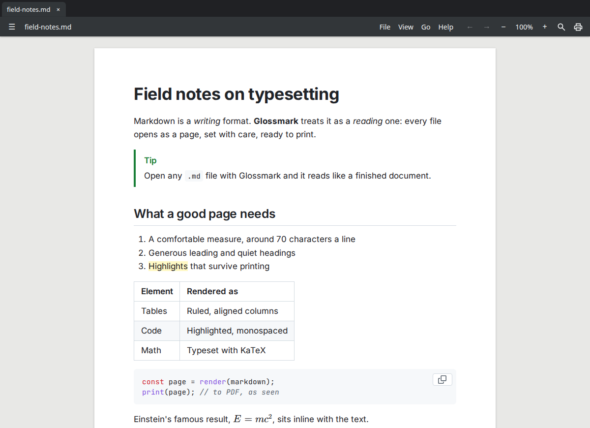

# Nacho Viewer

<!-- claude-arsenal:attribution: added by claude-arsenal's /init. Delete this block to drop it (it is not put back), or set `attribution = false` in the arsenal config.toml. -->

<!-- /claude-arsenal:attribution -->

**Markdown, beautifully printed.** A free, open-source document viewer for Linux, Windows and macOS
that makes `.md` files read like a well-typeset document instead of plain text. Images and PDF
pages come next; it stays a viewer, not an editor.

> Status: building v1. The specification is [`status/specification.md`](status/specification.md) and
> the task plan [`status/plan.md`](status/plan.md). `make dev` runs the app; `make lint test` is the gate.

## Planned for v1

- A paper-sheet reading view with book-quality typography, light and dark
- Everything GitHub renders (GFM, footnotes, alerts, emoji, math, Mermaid) plus extras
  (highlight, sup/sub, wiki links, abbreviations, definition lists)
- Tabs with back/forward, outline sidebar, live reload, zoom, print to PDF
- Built with [Tauri v2](https://v2.tauri.app/)

## Install

Every release is on [GitHub Releases](https://github.com/nuncaeslupus/nacho-viewer/releases). The
AppImage, .msi/.exe and .dmg update themselves; the other channels update through their store.

### Linux

- **Releases**: the `.deb` (`sudo apt install ./Nacho*Viewer_*.deb`) or the AppImage (`chmod +x`, then run it)
- **Flathub** (coming soon): `flatpak install flathub io.github.nuncaeslupus.NachoViewer`
- **Snap** (coming soon): `sudo snap install nacho-viewer`
- **apt repo** (coming soon): add the repo, then `sudo apt install nacho-viewer`

### Windows

- **Releases**: the `.msi` or `.exe` installer
- **winget** (coming soon): `winget install nuncaeslupus.NachoViewer`

The app is not code-signed yet, so SmartScreen may warn on first run: click **More info → Run anyway**.

### macOS

- **Releases**: the `.dmg`; drag Nacho Viewer to Applications
- **Homebrew** (coming soon): `brew install --cask nuncaeslupus/tap/nacho-viewer`

The app is not notarized, so macOS blocks the first launch. Open **System Settings › Privacy &
Security** and click **Open Anyway**, or run `xattr -dr com.apple.quarantine "/Applications/Nacho Viewer.app"`.

## License

[MIT](LICENSE)
