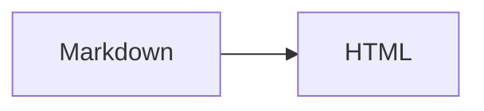

# All features

One example of every construct in Glossmark's v1 scope (D-7). Tests and later tasks render
this file and look for each construct's element.

## CommonMark

Plain text with *emphasis*, **strong emphasis**, `inline code`, a [link](https://example.com)
and a hard line break\
right here.

> A block quote.

1. An ordered list
2. with two items

- A bullet list
  - with a nested item

---

    an indented code block

```js
// A fenced code block with a language.
const answer = 42;
```

## GFM

| Left | Centre | Right |
| :--- | :----: | ----: |
| a    | b      | c     |

- [x] A finished task
- [ ] An open task

~~Strikethrough~~ and an autolink: www.example.com.

## Footnotes

A sentence with a footnote.[^note]

[^note]: The footnote text.

## Alerts

> [!NOTE]
> Useful information.

> [!TIP]
> Helpful advice.

> [!IMPORTANT]
> Key information.

> [!WARNING]
> Urgent information.

> [!CAUTION]
> Risks of an action.

## Emoji

Shortcodes become characters: :tada: :smile:

## Math

Inline math: $e^{i\pi} + 1 = 0$.

$$
\int_0^1 x^2 \, dx = \frac{1}{3}
$$

## Mermaid



## Extras

==Highlighted text==, 19^th^ and H~2~O.

A link to [[Another page]] and to [[Another page|another label]].

The HTML specification is maintained by the W3C.

*[HTML]: Hyper Text Markup Language
*[W3C]: World Wide Web Consortium

Term
: Its definition.

Another term
: Another definition.

## Safe raw HTML

<details>
<summary>More</summary>

Press <kbd>Ctrl</kbd>+<kbd>C</kbd>.

</details>

## Images


