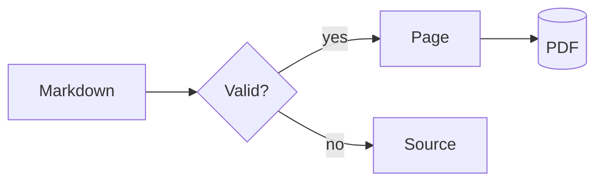
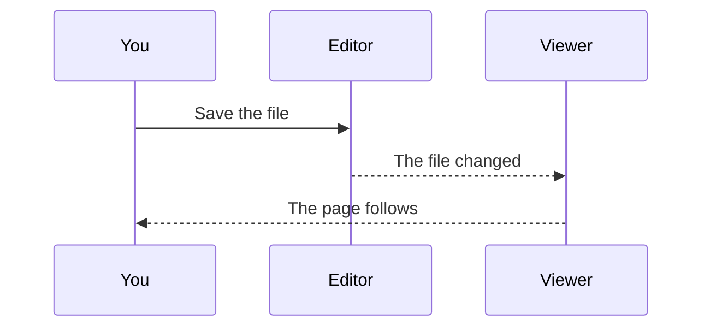
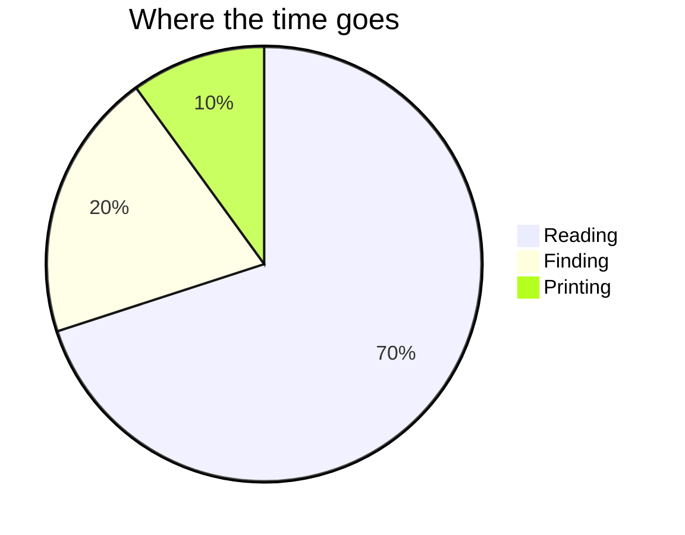
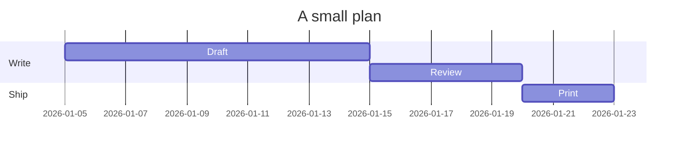
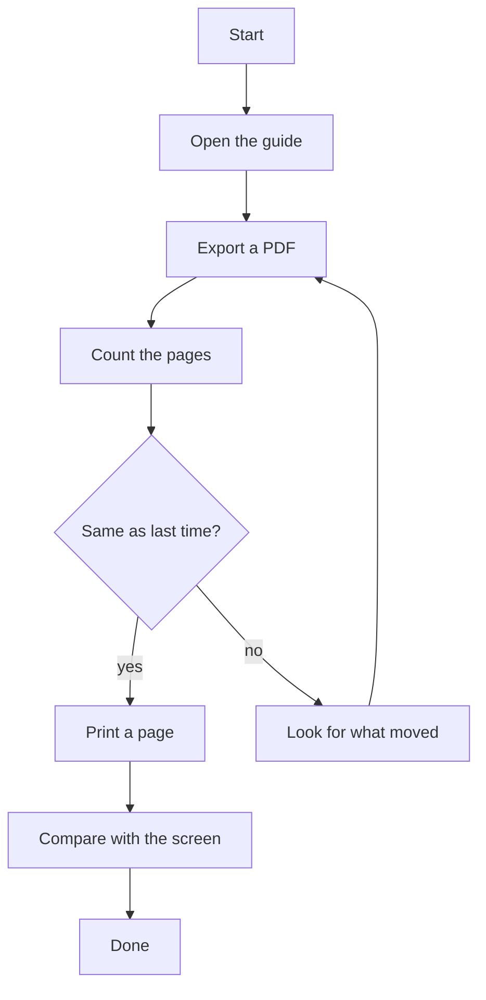

# Nacho Viewer Guide

Nacho Viewer opens Markdown files and shows them as a well-typeset document. It is a viewer, not
an editor: change a file in any editor and the page here follows.

This guide has three parts:

1. [Using the app](#using-the-app): how to read, find, print and export.
2. [What Markdown can show](#what-markdown-can-show): one example of everything the app renders.
3. [Print and export test](#print-and-export-test): the hard cases, to compare paper with screen.

## Using the app

### Open a document

- Press <kbd>Ctrl</kbd>+<kbd>O</kbd>, or the **+** beside the tabs.
- Drop a `.md` or `.markdown` file on the window.
- Pick one of the recent files on the start page. The **×** beside a file removes it from the list.
- Open a Markdown file from your file manager with Nacho Viewer.

Each document has its own tab. Right-click a tab for **Copy path** and to show the file in your
file manager.

> [!TIP]
> On macOS, read <kbd>Ctrl</kbd> as <kbd>Cmd</kbd> everywhere in this guide.

### Read

The **outline** (<kbd>Ctrl</kbd>+<kbd>B</kbd>) lists the document's headings; click one to go
there. Links work as they do in a browser, and **back** and **forward**
(<kbd>Alt</kbd>+<kbd>←</kbd>, <kbd>Alt</kbd>+<kbd>→</kbd>) retrace them in the tab:

- A link to another Markdown file opens it in the same tab; <kbd>Ctrl</kbd>+click opens a new tab.
- A link to a heading, like the ones at the top of this page, scrolls there.
- A link to a website opens in your browser.

Zoom with <kbd>Ctrl</kbd>+<kbd>+</kbd> and <kbd>Ctrl</kbd>+<kbd>-</kbd>, or go back to 100% with
<kbd>Ctrl</kbd>+<kbd>0</kbd>. <kbd>Ctrl</kbd>+<kbd>9</kbd> makes the page as wide as the window and
back again, which helps with wide tables.

**Find** (<kbd>Ctrl</kbd>+<kbd>F</kbd>) highlights every match; <kbd>F3</kbd> and
<kbd>Shift</kbd>+<kbd>F3</kbd> step through them. **View source**
(<kbd>Ctrl</kbd>+<kbd>U</kbd>) shows the file's plain text.

When the file changes on disk the page reloads by itself and keeps your place. If the file is
deleted, the last version stays on screen with a note at the top.

### Print and export

| To | Press | You get |
| :--- | :---- | :------ |
| Print | <kbd>Ctrl</kbd>+<kbd>P</kbd> | The system's print dialog |
| Export | <kbd>Ctrl</kbd>+<kbd>Shift</kbd>+<kbd>E</kbd> | A PDF file, A4 |

Both ask for a text size first, Small, Normal or Large, and **Preview** shows the PDF in your
system's viewer before you commit. Paper always uses the light colours, whatever the theme on
screen.

### Make it yours

**Settings** (<kbd>Ctrl</kbd>+<kbd>,</kbd>) has the theme (system, light or dark, also
<kbd>Ctrl</kbd>+<kbd>Shift</kbd>+<kbd>L</kbd>), the style of the page (Classic, Newspaper, Paper,
Docs or Typewriter) and whether images from the internet load.

For anything else, put your own CSS in `user.css` in the app's settings folder:

| System | Folder |
| :----- | :----- |
| Linux | `~/.config/nacho-viewer/` |
| Windows | `%APPDATA%\nacho-viewer\` |
| macOS | `~/Library/Application Support/nacho-viewer/` |

### Keyboard shortcuts

<kbd>F1</kbd> lists all of them. <kbd>Shift</kbd>+<kbd>F1</kbd> opens this guide.

### Get in touch

Nacho Viewer is free and open source. **About Nacho Viewer**, in the **⋮** menu, shows your
version. Report a problem or read the code on
[GitHub](https://github.com/nuncaeslupus/nacho-viewer).

## What Markdown can show

### Text

Plain text with *emphasis*, **strong emphasis**, ***both***, `inline code`,
~~strikethrough~~, ==highlighted text==, 19^th^ century and H~2~O. A [link](https://example.com),
an autolink www.example.com, and a hard line break\
right here. The emoji shortcode :tada: becomes a character.

The HTML specification is maintained by the W3C; hover those two names for their meaning.

*[HTML]: Hyper Text Markup Language
*[W3C]: World Wide Web Consortium

A sentence with a footnote,[^short] and another with a longer one.[^long]

[^short]: A short footnote.
[^long]: A longer footnote. It runs on for a little while, so that it wraps on to a second line on
    any page width and shows how footnote text is set.

A wiki link goes to another file by its name: [[Nacho Viewer Guide|this guide]].

### Headings

#### Fourth level

##### Fifth level

###### Sixth level

### Lists

1. An ordered list
2. with a second item
   1. and a nested one
   2. that keeps counting

- A bullet list
  - with a nested item
    - and a third level

- [x] A finished task
- [ ] An open task

Term
: A definition.

Another term
: Its first definition.
: Its second definition.

### Quotes and alerts

> A block quote.
>
> > With a quote inside it.

> [!NOTE]
> Useful information.

> [!TIP]
> Helpful advice.

> [!IMPORTANT]
> Key information.

> [!WARNING]
> Urgent information.

> [!CAUTION]
> Risks of an action.

---

### Tables

| Left | Centre | Right |
| :--- | :----: | ----: |
| one | two | 3 |
| *four* | `five` | 6.00 |
| A longer cell that has to wrap once the column runs out of room on the page | b | 1,234.56 |

### Code

    An indented code block.

```js
// JavaScript
const answer = [1, 2, 3].map((n) => n * 7);
console.log(`The answer is ${answer.at(-1) * 2}`);
```

```python
# Python
def greet(name: str = "world") -> str:
    return f"Hello, {name}!"
```

```rust
// Rust
fn main() {
    let total: u32 = (1..=9).sum();
    println!("{total}");
}
```

```bash
# Shell
for file in *.md; do wc -l "$file"; done
```

```json
{ "name": "Nacho Viewer", "free": true, "platforms": ["Linux", "Windows", "macOS"] }
```

```diff
- The old line
+ The new line
```

### Math

Inline math: $e^{i\pi} + 1 = 0$ and $\sqrt{a^2 + b^2}$.

$$
\int_0^1 x^2 \, dx = \frac{1}{3}
\qquad
\sum_{n=1}^{\infty} \frac{1}{n^2} = \frac{\pi^2}{6}
$$

$$
\begin{pmatrix} a & b \\ c & d \end{pmatrix}
\begin{pmatrix} x \\ y \end{pmatrix}
=
\begin{pmatrix} ax + by \\ cx + dy \end{pmatrix}
$$

### Diagrams

A diagram has zoom and pan controls when you hover it.









### Images

A local SVG takes the colour of the text, so it follows the theme:


A local picture, with an `` tag that sets its size:


### Raw HTML

Safe HTML works; scripts and styles are removed.

<details>
<summary>A section that opens</summary>

Press <kbd>Ctrl</kbd>+<kbd>C</kbd> to copy.

</details>

## Print and export test

Print or export this guide to check paper against screen. The content never changes between runs
on the same version, so two exports should have the same pages, and a page count from one system
should be within one page of another.

Check that:

- [ ] Pages are A4, with a margin on every side.
- [ ] Each page starts with text, not a sliced line or half an image.
- [ ] The app's own bars and buttons do not print, nor do the diagrams' controls.
- [ ] Colours are the light ones, even with the dark theme on screen.
- [ ] Footnotes, alerts, math and diagrams look as they do on screen.

### A wide table

| Quarter | Region | Product | Units | Price | Revenue | Cost | Margin | Owner | Status |
| :------ | :----- | :------ | ---: | ---: | -----: | ---: | -----: | :---- | :----- |
| Q1 | Northern Europe | Reader Standard | 1,204 | 19.00 | 22,876.00 | 9,150.40 | 13,725.60 | Asha | Shipped |
| Q2 | Southern Europe | Reader Standard | 987 | 19.00 | 18,753.00 | 7,501.20 | 11,251.80 | Bruno | Shipped |
| Q3 | North America | Reader Professional | 2,310 | 49.00 | 113,190.00 | 39,616.50 | 73,573.50 | Chidi | In progress |
| Q4 | Asia and the Pacific | Reader Professional | 1,875 | 49.00 | 91,875.00 | 32,156.25 | 59,718.75 | Dana | Planned |

### A long table

A header row, and rows that should never split across two pages.

| # | Item | Note |
| ---: | :--- | :--- |
| 1 | Alpha | First of the rows |
| 2 | Bravo | Second |
| 3 | Charlie | Third |
| 4 | Delta | Fourth |
| 5 | Echo | Fifth |
| 6 | Foxtrot | Sixth |
| 7 | Golf | Seventh |
| 8 | Hotel | Eighth |
| 9 | India | Ninth |
| 10 | Juliett | Tenth |
| 11 | Kilo | Eleventh |
| 12 | Lima | Twelfth |
| 13 | Mike | Thirteenth |
| 14 | November | Fourteenth |
| 15 | Oscar | Fifteenth |
| 16 | Papa | Sixteenth |
| 17 | Quebec | Seventeenth |
| 18 | Romeo | Eighteenth |
| 19 | Sierra | Nineteenth |
| 20 | Tango | Twentieth |
| 21 | Uniform | Twenty-first |
| 22 | Victor | Twenty-second |
| 23 | Whiskey | Twenty-third |
| 24 | X-ray | Twenty-fourth |
| 25 | Yankee | Twenty-fifth |
| 26 | Zulu | Last of the rows |

### Very long lines

A code line far wider than the page:

```text
0123456789 abcdefghij 0123456789 abcdefghij 0123456789 abcdefghij 0123456789 abcdefghij 0123456789 abcdefghij 0123456789 abcdefghij 0123456789 abcdefghij
```

A word that has no place to break: Pneumonoultramicroscopicsilicovolcanoconiosis_Pneumonoultramicroscopicsilicovolcanoconiosis_Pneumonoultramicroscopicsilicovolcanoconiosis.

A long address: <https://example.com/a/very/long/path/that/keeps/going/and/going/well/past/the/edge/of/the/sheet/on/any/paper/size>.

### A long code block

This block is longer than most pages can hold, so it has to continue on the next one.

```python
# Sixty numbered lines.
line_01 = "one"
line_02 = "two"
line_03 = "three"
line_04 = "four"
line_05 = "five"
line_06 = "six"
line_07 = "seven"
line_08 = "eight"
line_09 = "nine"
line_10 = "ten"
line_11 = "eleven"
line_12 = "twelve"
line_13 = "thirteen"
line_14 = "fourteen"
line_15 = "fifteen"
line_16 = "sixteen"
line_17 = "seventeen"
line_18 = "eighteen"
line_19 = "nineteen"
line_20 = "twenty"
line_21 = "twenty-one"
line_22 = "twenty-two"
line_23 = "twenty-three"
line_24 = "twenty-four"
line_25 = "twenty-five"
line_26 = "twenty-six"
line_27 = "twenty-seven"
line_28 = "twenty-eight"
line_29 = "twenty-nine"
line_30 = "thirty"
line_31 = "thirty-one"
line_32 = "thirty-two"
line_33 = "thirty-three"
line_34 = "thirty-four"
line_35 = "thirty-five"
line_36 = "thirty-six"
line_37 = "thirty-seven"
line_38 = "thirty-eight"
line_39 = "thirty-nine"
line_40 = "forty"
line_41 = "forty-one"
line_42 = "forty-two"
line_43 = "forty-three"
line_44 = "forty-four"
line_45 = "forty-five"
line_46 = "forty-six"
line_47 = "forty-seven"
line_48 = "forty-eight"
line_49 = "forty-nine"
line_50 = "fifty"
line_51 = "fifty-one"
line_52 = "fifty-two"
line_53 = "fifty-three"
line_54 = "fifty-four"
line_55 = "fifty-five"
line_56 = "fifty-six"
line_57 = "fifty-seven"
line_58 = "fifty-eight"
line_59 = "fifty-nine"
line_60 = "sixty"
```

### A tall diagram



### Text that runs on

Long paragraphs show the page's rhythm: line length, word spacing and how text flows from one
page to the next. A good page keeps a heading with the text that follows it, and never leaves one
line of a paragraph stranded at the top or bottom of a page.

Typesetters call those stranded lines widows and orphans. Keeping them off the page matters more
on paper than on screen, because a reader can scroll a screen but cannot scroll a page. The same
goes for a heading at the foot of a page, with its text overleaf: the eye lands on a promise and
has to turn the page to see it kept.

Nothing here needs reading closely. It is enough to look at the last line of each page and the
first line of the next, and see that the text carries on as it should. If it does, the page breaks
are working.
